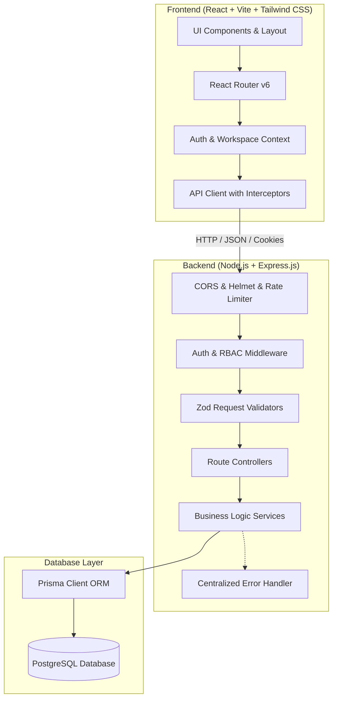

# ProjectFlow — System Architecture

## 1. Architectural Overview

ProjectFlow is designed with a clean separation of concerns, multi-tenant workspace isolation, and an API-first backend architecture.



---

## 2. Frontend Architecture

### 2.1 Stack & Principles
- **Runtime & Bundler**: React 18+ with Vite (blazing fast HMR and optimized production bundling).
- **Language**: JavaScript (ESNext).
- **Styling**: Tailwind CSS with custom design tokens adhering to `DESIGN_SYSTEM.md`.
- **Routing**: React Router v6 with route guards for authenticated sessions and public-only flows.
- **Icons**: Lucide React.
- **Drag-and-Drop**: `@dnd-kit/core`, `@dnd-kit/sortable`, `@dnd-kit/utilities` for keyboard-accessible 60fps Kanban interactions.

### 2.2 Directory Structure
```text
client/
├── public/
├── src/
│   ├── assets/
│   ├── components/
│   │   ├── ui/               # Primitives: Button, Input, Modal, Badge, Dropdown, Tooltip, Skeleton, EmptyState
│   │   ├── layout/           # AppShell, Sidebar, TopNav, Breadcrumbs, UserMenu, WorkspaceSwitcher
│   │   ├── dashboard/        # MetricsCard, RecentProjects, TaskActivityFeed
│   │   ├── projects/         # ProjectCard, ProjectTable, ProjectHeader, ProjectFormModal
│   │   ├── tasks/            # TaskCard, TaskDetailDrawer, TaskFormModal, PriorityBadge, StatusBadge
│   │   └── workspace/        # MemberTable, InviteModal, WorkspaceSettingsForm
│   ├── context/              # AuthContext, WorkspaceContext, ToastContext
│   ├── hooks/                # useAuth, useWorkspace, useTasks, useDebounce, useMediaQuery
│   ├── pages/                # Route Views: Login, Register, Dashboard, Projects, Board, Team, Settings
│   ├── services/             # api.js, authService, workspaceService, projectService, taskService
│   ├── utils/                # cn.js, formatters.js, constants.js
│   ├── App.jsx
│   ├── main.jsx
│   └── index.css
├── index.html
├── tailwind.config.js
└── vite.config.js
```

### 2.3 Frontend State & Data Flow
- **Authentication & Active Context**: Global context (`AuthContext` and `WorkspaceContext`) holds active session info and the currently selected workspace.
- **Data Fetching & Optimistic Updates**: Dedicated service hooks manage data fetching. The Kanban board applies local state reordering immediately, triggers the backend `move` endpoint asynchronously, and rolls back upon network error with a toast alert.

---

## 3. Backend Architecture

### 3.1 Stack & Modular Layering
- **Runtime**: Node.js (LTS).
- **Framework**: Express.js with a strict 4-layer structure:
  1. **Route Layer**: Declares endpoints, attaches rate-limiters, authenticates tokens, and binds Zod schema middleware.
  2. **Controller Layer**: Extracts validated params/body, delegates to domain services, formats response envelope.
  3. **Service Layer**: Implements core business logic, verifies RBAC rules, coordinates Prisma transactions, logs activity records.
  4. **Data Access Layer**: Prisma ORM with typed client queries.

### 3.2 Directory Structure
```text
server/
├── prisma/
│   ├── schema.prisma
│   ├── seed.js
│   └── migrations/
└── src/
    ├── config/           # env.js (validated with Zod), database.js (Prisma singleton)
    ├── controllers/      # authController, workspaceController, projectController, taskController
    ├── middleware/       # authenticate.js, authorize.js, validate.js, errorHandler.js, rateLimiter.js
    ├── routes/           # authRoutes, workspaceRoutes, projectRoutes, taskRoutes, index.js
    ├── services/         # authService, workspaceService, projectService, taskService, activityService
    ├── validators/       # authSchemas, workspaceSchemas, projectSchemas, taskSchemas
    ├── utils/            # jwt.js, password.js, response.js, AppError.js, logger.js
    ├── app.js            # Express app configuration & middleware mounts
    └── server.js         # HTTP server listener & graceful shutdown handlers
```

---

## 4. Security, Authentication & Authorization

### 4.1 Authentication Flow
1. User logs in via `/api/auth/login`.
2. Password verified with `bcrypt.compare`.
3. Server generates JWT signed with `JWT_SECRET` (containing `userId` and token version).
4. Token is transmitted via **HTTP-only, SameSite=Lax (or Strict), Secure** cookie to prevent XSS exfiltration.
5. In addition, an optional `Session` row tracks active device/refresh state for revocation capabilities.

### 4.2 Multi-Tenant Authorization (RBAC)
Every request to a workspace or project resource passes through authorization middleware:
- **`requireWorkspaceMember`**: Checks whether `req.user.id` is present in `workspace_members` for the target `workspaceId`. Rejects with 403 Forbidden if not.
- **`requireWorkspaceRole(role)`**: Enforces minimum role (`ADMIN`, `OWNER`) for structural modifications (e.g. inviting members, updating billing, deleting workspace).
- **Never trust client-supplied tenant IDs**: The server validates that the requested project or task genuinely belongs to the authenticated workspace.

---

## 5. Error Handling & Validation

### 5.1 Validation via Zod
All inputs are validated before controller logic executes:
```javascript
const validate = (schema) => (req, res, next) => {
  try {
    req.body = schema.parse(req.body);
    next();
  } catch (err) {
    next(new ValidationError(err.errors));
  }
};
```

### 5.2 Centralized Error Middleware
A centralized Express error handler converts known `AppError` instances, Prisma database exceptions (e.g., unique constraint `P2002`, record not found `P2025`), and unexpected errors into uniform JSON error payloads. Sensitive stack traces are excluded in production environments.
