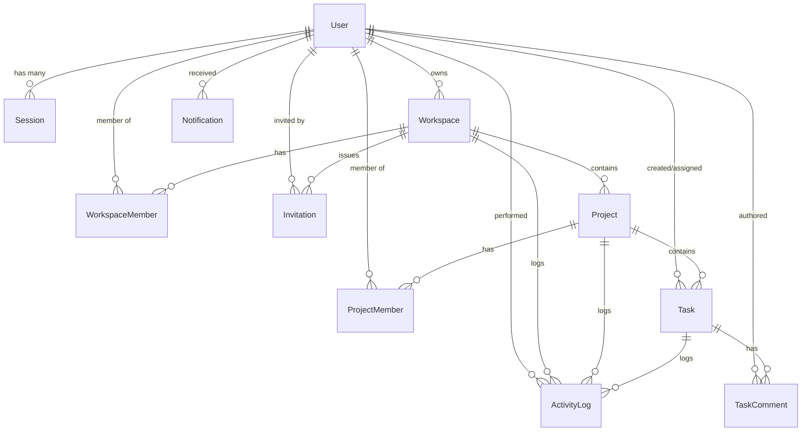

# ProjectFlow — Database Schema & Data Modeling

This document defines the PostgreSQL relational database architecture for ProjectFlow, managed via Prisma ORM.

---

## 1. Entity-Relationship Overview



---

## 2. Enumerated Types (Enums)

```prisma
enum WorkspaceRole {
  OWNER
  ADMIN
  MEMBER
}

enum ProjectStatus {
  PLANNING
  ACTIVE
  ON_HOLD
  COMPLETED
  ARCHIVED
}

enum ProjectRole {
  LEAD
  MEMBER
  VIEWER
}

enum TaskStatus {
  TODO
  IN_PROGRESS
  IN_REVIEW
  DONE
}

enum TaskPriority {
  LOW
  MEDIUM
  HIGH
  URGENT
}

enum ActivityAction {
  WORKSPACE_CREATED
  WORKSPACE_UPDATED
  MEMBER_INVITED
  MEMBER_JOINED
  MEMBER_REMOVED
  PROJECT_CREATED
  PROJECT_UPDATED
  PROJECT_ARCHIVED
  TASK_CREATED
  TASK_UPDATED
  TASK_MOVED
  TASK_DELETED
  COMMENT_ADDED
}

enum NotificationType {
  TASK_ASSIGNED
  TASK_DUE_SOON
  TASK_COMMENT
  WORKSPACE_INVITE
  PROJECT_MENTION
}
```

---

## 3. Relational Table Definitions

### 3.1 User & Session
```prisma
model User {
  id            String    @id @default(uuid())
  name          String
  email         String    @unique
  passwordHash  String
  avatarUrl     String?
  createdAt     DateTime  @default(now())
  updatedAt     DateTime  @updatedAt

  // Relationships
  sessions          Session[]
  ownedWorkspaces   Workspace[]       @relation("WorkspaceOwner")
  workspaceMembers  WorkspaceMember[]
  sentInvitations   Invitation[]      @relation("InvitedByUser")
  projectMembers    ProjectMember[]
  createdProjects   Project[]         @relation("ProjectCreator")
  assignedTasks     Task[]            @relation("TaskAssignee")
  createdTasks      Task[]            @relation("TaskCreator")
  taskComments      TaskComment[]
  activityLogs      ActivityLog[]
  notifications     Notification[]

  @@index([email])
  @@map("users")
}

model Session {
  id           String   @id @default(uuid())
  userId       String
  refreshToken String   @unique
  userAgent    String?
  ipAddress    String?
  expiresAt    DateTime
  createdAt    DateTime @default(now())

  user User @relation(fields: [userId], references: [id], onDelete: Cascade)

  @@index([userId])
  @@index([refreshToken])
  @@map("sessions")
}
```

### 3.2 Workspace & Membership
```prisma
model Workspace {
  id          String   @id @default(uuid())
  name        String
  description String?
  slug        String   @unique
  ownerId     String
  createdAt   DateTime @default(now())
  updatedAt   DateTime @updatedAt

  // Relationships
  owner        User              @relation("WorkspaceOwner", fields: [ownerId], references: [id], onDelete: Restrict)
  members      WorkspaceMember[]
  invitations  Invitation[]
  projects     Project[]
  activityLogs ActivityLog[]

  @@index([ownerId])
  @@index([slug])
  @@map("workspaces")
}

model WorkspaceMember {
  id          String        @id @default(uuid())
  workspaceId String
  userId      String
  role        WorkspaceRole @default(MEMBER)
  joinedAt    DateTime      @default(now())

  workspace Workspace @relation(fields: [workspaceId], references: [id], onDelete: Cascade)
  user      User      @relation(fields: [userId], references: [id], onDelete: Cascade)

  @@unique([workspaceId, userId])
  @@index([workspaceId])
  @@index([userId])
  @@map("workspace_members")
}

model Invitation {
  id          String        @id @default(uuid())
  workspaceId String
  email       String
  role        WorkspaceRole @default(MEMBER)
  tokenHash   String        @unique
  expiresAt   DateTime
  acceptedAt  DateTime?
  invitedById String
  createdAt   DateTime      @default(now())

  workspace Workspace @relation(fields: [workspaceId], references: [id], onDelete: Cascade)
  invitedBy User      @relation("InvitedByUser", fields: [invitedById], references: [id], onDelete: Cascade)

  @@index([workspaceId])
  @@index([email])
  @@index([tokenHash])
  @@map("invitations")
}
```

### 3.3 Project & Project Members
```prisma
model Project {
  id          String        @id @default(uuid())
  name        String
  description String?
  workspaceId String
  createdById String
  status      ProjectStatus @default(ACTIVE)
  startDate   DateTime?
  dueDate     DateTime?
  createdAt   DateTime      @default(now())
  updatedAt   DateTime      @updatedAt

  workspace    Workspace       @relation(fields: [workspaceId], references: [id], onDelete: Cascade)
  createdBy    User            @relation("ProjectCreator", fields: [createdById], references: [id], onDelete: Restrict)
  members      ProjectMember[]
  tasks        Task[]
  activityLogs ActivityLog[]

  @@index([workspaceId])
  @@index([createdById])
  @@index([status])
  @@map("projects")
}

model ProjectMember {
  id        String      @id @default(uuid())
  projectId String
  userId    String
  role      ProjectRole @default(MEMBER)
  joinedAt  DateTime    @default(now())

  project Project @relation(fields: [projectId], references: [id], onDelete: Cascade)
  user    User    @relation(fields: [userId], references: [id], onDelete: Cascade)

  @@unique([projectId, userId])
  @@index([projectId])
  @@index([userId])
  @@map("project_members")
}
```

### 3.4 Tasks, Comments & Interactions
```prisma
model Task {
  id          String       @id @default(uuid())
  title       String
  description String?      @db.Text
  projectId   String
  assigneeId  String?
  createdById String
  status      TaskStatus   @default(TODO)
  priority    TaskPriority @default(MEDIUM)
  dueDate     DateTime?
  position    Float        @default(1000.0)
  createdAt   DateTime     @default(now())
  updatedAt   DateTime     @updatedAt

  project      Project       @relation(fields: [projectId], references: [id], onDelete: Cascade)
  assignee     User?         @relation("TaskAssignee", fields: [assigneeId], references: [id], onDelete: SetNull)
  createdBy    User          @relation("TaskCreator", fields: [createdById], references: [id], onDelete: Restrict)
  comments     TaskComment[]
  activityLogs ActivityLog[]

  @@index([projectId])
  @@index([assigneeId])
  @@index([status])
  @@index([position])
  @@map("tasks")
}

model TaskComment {
  id        String   @id @default(uuid())
  taskId    String
  userId    String
  content   String   @db.Text
  createdAt DateTime @default(now())
  updatedAt DateTime @updatedAt

  task Task @relation(fields: [taskId], references: [id], onDelete: Cascade)
  user User @relation(fields: [userId], references: [id], onDelete: Cascade)

  @@index([taskId])
  @@index([userId])
  @@map("task_comments")
}
```

### 3.5 Auditing & Notifications
```prisma
model ActivityLog {
  id          String         @id @default(uuid())
  workspaceId String
  projectId   String?
  taskId      String?
  userId      String
  action      ActivityAction
  metadata    Json?
  createdAt   DateTime       @default(now())

  workspace Workspace @relation(fields: [workspaceId], references: [id], onDelete: Cascade)
  project   Project?  @relation(fields: [projectId], references: [id], onDelete: SetNull)
  task      Task?     @relation(fields: [taskId], references: [id], onDelete: SetNull)
  user      User      @relation(fields: [userId], references: [id], onDelete: Cascade)

  @@index([workspaceId])
  @@index([projectId])
  @@index([taskId])
  @@index([userId])
  @@map("activity_logs")
}

model Notification {
  id        String           @id @default(uuid())
  userId    String
  type      NotificationType
  title     String
  message   String
  isRead    Boolean          @default(false)
  linkUrl   String?
  createdAt DateTime         @default(now())

  user User @relation(fields: [userId], references: [id], onDelete: Cascade)

  @@index([userId, isRead])
  @@map("notifications")
}
```

---

## 4. Key Architectural Safeguards in Schema
1. **Fractional Positioning for Kanban**: The `position` field on `Task` is typed as a `Float` (default `1000.0`). When moving cards between cards `A` and `B`, the new position is calculated as `(posA + posB) / 2`. This avoids expensive $O(N)$ sequential updates to all subsequent records in the column. Rebalancing occurs only on fractional collision.
2. **Safe Deletions**:
   - `onDelete: Cascade` is scoped to children dependent on parent containers (Workspace -> WorkspaceMember, Project -> Task, Task -> TaskComment).
   - `onDelete: SetNull` is used for assignees so deleting or removing a user does not delete their tasks.
   - `onDelete: Restrict` is enforced on Project Creator and Workspace Owner to prevent orphaned data.
3. **Compound Unique Constraints**:
   - `[workspaceId, userId]` prevents double-joining a workspace.
   - `[projectId, userId]` prevents duplicate project membership.
